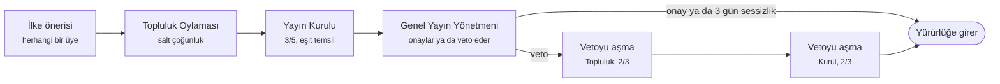

# Ortak Akıl — Proje Raporu

2 Ekim 2026

**Ortak Akıl, gündemi vatandaşların belirlediği ve sonucu vatandaşların oyladığı sansürsüz bir kamuoyu platformudur.** Karar düzeni ABD yasama sistemini örnek alır. Ödevin 11 isteğinin tamamı çalışan bir özellikle karşılandı. Platform ücretsizdir ve tek komutla hem bilgisayarda hem telefonda çalışır.

## Öne çıkanlar

- **Sansür yok.** ABD'nin 1. Değişikliği örnek alındı. Tek yasak gerçek tehdittir.
- **Çoğunluk azınlığı ezemez.** Kurulda her bölüm eşit temsil edilir ve kabul için 3/5 gerekir.
- **Kurallar oylamayla değişir.** Eşikler ve süreler koda gömülü değil. Topluluk kendi anayasasını yazar.
- **Fikirler karar vericiye ulaşır.** Bakanlıkların resmî yanıtları silinmeden kayda geçer ve Etki raporunda izlenir.
- **Sıfır maliyet.** Ücretli servis ya da dış API yok. YZ Analist kural tabanlı çalışır.

## Problem ve amaç

Sosyal medyada çok ses var ama ortak bir sonuç yok. Forumlarda ise neyin kalacağına çoğu zaman tek bir moderatör karar verir. Kamuoyunun birlikte düşündüğü, bir sonuca vardığı ve bu sonucu karar vericilere ulaştırdığı bir yer eksik.

Ortak Akıl bu boşluğu "editörü topluluğun kendisi olan bağımsız bir medya kuruluşu" fikriyle doldurur. Bir fikrin platformdaki yolu dört adımdan oluşur:

1. Vatandaşlar gündem önerir ve hangi konunun tartışılacağını oylar.
2. Tartışma sansürsüz yürütülür ve hiçbir mesaj silinmez.
3. Konu, yarışan uzlaşma önerilerinden birinin oylamayla kabulüyle kapanır.
4. Uzlaşılan fikir ilgili bakanlık ya da meclis komisyonuna ulaşır. Kurumun yanıtı herkesin gözü önünde kayda geçer.

Demodaki ülke kurgusaldır ve gerçek kişi, parti ya da kurum adı kullanılmaz. Gündem ise gerçekçidir: hukuk, ekonomi, eğitim, sağlık, çevre, dijital haklar ve şehirler. Sağ, sol ve merkez görüşlerden kullanıcılar aynı masada tartışır. Böylece platformun farklı görüşleri bir arada tutup tutamadığı demo sırasında görülebilir.

## İstekler ve karşılıkları

| İstek | Karşılığı |
| --- | --- |
| Kayıt ve giriş | Şifreler bcrypt ile saklanır. Adres ve doğum tarihi yalnızca sahibine görünür. |
| Konu açma ve oylama | Herkes gündem önerir. Bölümü takip edenler salt çoğunlukla karar verir. |
| Alt konular | Açık her konuya alt başlık önerilir ve oylanır. |
| Ontoloji ve uygunluk | 11 ana, 8 alt bölüm var. Öneri 0–100 puanlanır ama engellenmez. |
| Silme ve düzenleme | Önerilir ve iki aşamalı oylamadan geçer. Mesajlar asla silinmez. |
| Uzlaşma | Öneriler yarışır. Kaybeden taraf kalıcı bir azınlık görüşü yazar. |
| Oy havalesi | Bölüm bazında oy emaneti var, kişi başı en fazla 5 oy. |
| YZ kullanıcı | YZ Analist tartışmayı özetler, uzlaşma taslağı çıkarır. Oy kullanmaz. |
| Dağıtık defter | Her olay SHA-256 hash zincirine yazılır. Herkes zinciri doğrulayabilir. |
| Graf | Üyeler arası etkileşim ve oy emaneti ağı çizilir. |
| Uygulama ve web sitesi | Aynı kod hem web sitesi hem telefona kurulan uygulama (PWA) olarak çalışır. |

## Karar düzeni



*Herhangi bir oylamada red çıkarsa öneri düşer; veto aşılamazsa veto geçerli kalır. Konu ve uzlaşma önerileri Topluluk Oylaması'nda, gizleme ve düzenleme önerileri Yayın Kurulu'nda sonuçlanır.*

Topluluk Oylaması Temsilciler Meclisi'ne, Yayın Kurulu Senato'ya, Genel Yayın Yönetmeni Başkan'a karşılık gelir. Yönetmenin vetosu son söz değildir, topluluk 2/3 ile aşabilir.

| ABD | Ortak Akıl |
| --- | --- |
| Temsilciler Meclisi | Topluluk Oylaması (bölümü takip edenler, salt çoğunluk) |
| Senato, eyalet başına 2 senatör | Yayın Kurulu, bölüm başına 2 kurul üyesi |
| Başkanın imzası ya da vetosu | Genel Yayın Yönetmeni'nin onayı ya da vetosu |
| Vetonun 2/3 ile aşılması | Vetoyu aşma oylaması, iki aşamada da 2/3 |
| Filibuster ve 60 oy kuralı | Yayın Kurulu'nda 3/5 şartı |
| 1. Değişiklik | Tehdit dışında sansür yok |
| Özgür basının denetim işlevi | Kurum hesapları ve etki takibi |

Her öneri aynı uzunlukta bir yoldan geçmez. Yol, önerinin ağırlığına göre belirlenir. Bu, ABD'deki basit karar, ortak karar ve yasa ayrımının karşılığıdır:

| Öneri türü | ABD karşılığı | Geçtiği aşamalar |
| --- | --- | --- |
| Konu önerisi, uzlaşma önerisi | Basit karar | Topluluk Oylaması |
| Mesaj gizleme, konu kaldırma, konu düzenleme | Ortak karar | Topluluk Oylaması, Yayın Kurulu |
| İlke önerisi | Yasa | Topluluk Oylaması, Yayın Kurulu, Genel Yayın Yönetmeni |

Bu eşiklerin hiçbiri koda gömülü değil. Çoğunluk türü, kurul kabul oranı, veto aşım oranı, bölüm başına koltuk sayısı, oylama süresi ve oy ağırlığı sınırı birer ilke önerisiyle değiştirilebilir. Yani topluluk kendi anayasasını da oylamayla yeniden yazabilir.

Oylama süresi varsayılan olarak 3 gündür. Sonuç kesinleşince oylama süre dolmadan kapanır. Yönetmen 3 gün içinde karar vermezse öneri kendiliğinden yürürlüğe girer. Böylece tek bir kişi bir kararı sessizce bekleterek engelleyemez.

## Roller ve seçimler

Platformda altı rol vardır. Dördü hesabın türünden gelir, ikisi ise seçimle kazanılan görevlerdir. Hiçbir görev atamayla verilmez.

| Rol | Nasıl edinilir | Yetkisi | Sınırı |
| --- | --- | --- | --- |
| Vatandaş | Kayıt olarak | Önerir, tartışır, oy verir, aday olur | Taşıyabileceği oy en fazla 5 |
| Uzman | Hesap türü | Vatandaşın bütün yetkileri, rozetle görünür | Oyu diğerleriyle eş ağırlıkta |
| YZ Analist | Sistem hesabı | Tartışmayı özetler, uzlaşma taslağı çıkarır | Oy veremez, aday olamaz, giriş yapılamaz |
| Kurum hesabı | Doğrulanmış bakanlık ya da komisyon | Resmî açıklama ve resmî tepki verir | Oy veremez, gizleme öneremez |
| Yayın Kurulu üyesi | Bölüm üyelerinin desteğiyle | Önerileri ikinci aşamada oylar | Oy emaneti kullanamaz, kişisel oy verir |
| Genel Yayın Yönetmeni | Tüm üyelerin desteğiyle | İlke önerilerini onaylar ya da veto eder | Vetosu 2/3 ile aşılabilir, 3 gün sessizlik onay sayılır |

Seçimler "sürekli destek" usulüyle yapılır. Herkes tek bir makama ve tek bir bölüme aday olabilir. Yayın Kurulu için bölümün üyeleri, koltuk sayısı kadar adaya destek verir. En çok desteklenen adaylar kurula girer. Genel Yayın Yönetmeni için ise her üye tek bir adaya destek verir.

Destek her an geri çekilebilir ve sonuçlar anında yeniden hesaplanır. Bu yüzden üyeler dönem sonunu beklemeden güvenini kaybeden bir yöneticiyi yerinden edebilir. Eşitlik olursa önce aday olan öne geçer.

## Azınlığın korunması ve sansür ilkesi

Salt çoğunluk hızlı karar verir ama azınlığı ezebilir. Ortak Akıl bu riski dört mekanizmayla dengeler:

1. **Eşit temsil.** Yayın Kurulu'nda her ana bölüm, üye sayısından bağımsız olarak 2 koltukla temsil edilir. Kalabalık bir bölüm küçük bir bölümü kurulda ezemez.
2. **Nitelikli çoğunluk.** Kurulda kabul için 3/5 gerekir. 2/5'lik bir azınlık bir öneriyi durdurabilir.
3. **Kalıcı azınlık görüşü.** Uzlaşmaya katılmayanlar gerekçelerini yazar. Bu metin uzlaşmanın yanında kalıcı olarak durur, tıpkı yüksek mahkemelerdeki karşı oy yazıları gibi.
4. **Oy emanetinde tavan.** Oyunu başkasına emanet etmek serbesttir ama bir kişi en fazla 5 oy taşıyabilir. Oy toplayıp platformu tek başına yöneten biri çıkamaz.

Sansür konusunda ABD Anayasası'nın 1. Değişikliği örnek alındı. Hakaret dahil her ifade serbesttir. Tek istisna, ABD Yüksek Mahkemesi'nin *gerçek tehdit* (true threat) tanımıdır (Virginia v. Black 2003, Counterman v. Colorado 2023).

Tehdit denetimi yanlış alarm vermeyecek şekilde tasarlandı. Bir ifade iki durumda tehdit sayılır: açık bir tehdit kalıbı içeriyorsa ("adresini biliyorum") ya da aynı cümlede birinci tekil şahıs şiddet fiiliyle bir hedef birlikte geçiyorsa. Böylece "YZ insanlığı öldürür mü?" gibi bir tartışma başlığı engellenmez.

Mesajlar düzenlenemez ve silinemez. Topluluğun bir mesajı gizlemesi bile Topluluk Oylaması ve Yayın Kurulu'ndan geçen bir öneri gerektirir. Kabul edilse bile mesajın kaydı ve özeti arşivde kalır.

## Şeffaflık ve hesap verebilirlik

Platformda olan her şey sonradan doğrulanabilir. Kurumların verdiği sözler de herkesin gözü önünde takip edilir.

**Açık Arşiv.** Ödevdeki "dağıtık defter" isteğini karşılar. Her olay, bir önceki kaydın hash'ini içeren yeni bir kayıt olarak yazılır. Geçmişteki tek bir kayıt değiştirilirse ondan sonraki bütün hash'ler tutmaz hale gelir. Zincir her açılışta doğrulanır. Herkes defterin tamamını indirip kendi kopyasında kontrol edebilir. Kopyalar çoğaldıkça denetim de dağıtık hale gelir.

**Kurum hesapları.** Bakanlıklar ve meclis komisyonları doğrulanmış hesaplarla katılır. Resmî açıklama yazabilir ve kamuoyuna danışmak için gündem önerebilirler. Ancak oy kullanamaz, aday olamaz, oy emaneti alamaz ve hiçbir içeriğin gizlenmesini öneremezler. Devlet tartışmaya katılabilir ama tartışmayı yönlendiremez.

**Etki raporu.** Uzlaşmayla kapanan her konuya kurumlar dört resmî tepkiden birini verir: *İnceleniyor*, *Gündeme alındı*, *Uygulandı* ya da *Gerekçeli ret*. Tepkiler silinmez. Bir kurum tutum değiştirirse eski tutumu da geçmişiyle birlikte görünür ve arşive yazılır. `/etki` sayfası platformun asıl sorusunu cevaplar: Topluluğun fikirleri karar vericilere ulaşıyor mu?

## Yapay zekâ ve ontoloji

Platformdaki yapay zekâ karar vermez, kararlara yardım eder. Kullanımı tamamen ücretsizdir.

**YZ Analist.** Forumda `yz_bilirkisi` adıyla görünen bir üyedir. Ödevdeki "bazı kullanıcılar API ile bağlı yapay zekâ olabilir" isteğini karşılar. Uzun bir tartışmayı özetler, sık geçen ortak kavramları çıkarır ve katılma ile itiraz işaretlerini sayar. Ardından üyelerin düzenleyebileceği bir uzlaşma taslağı hazırlar.

- Varsayılan olarak kural tabanlı çalışır. Çıkarımsal özetleme yapar: cümleleri tartışmadaki sık kavramlara göre puanlar ve en iyilerini seçer. Hiçbir dış API çağrılmaz.
- Bilgisayarda ücretsiz [Ollama](https://ollama.com) kuruluysa özeti yerel bir dil modeli yazar (örneğin llama3.2). Model yanıt vermezse kural tabanlı özete geri dönülür.
- Oy kullanamaz, aday olamaz, kendisine oy devredilemez. Şifresi geçersiz bir değer olduğu için kimse bu hesapla giriş yapamaz.

**Ontoloji ve uygunluk raporu.** Konular 11 ana ve 8 alt bölümden oluşan bir ağaçta sınıflandırılır. Her bölümün kendine ait anahtar kelimeleri vardır. Bir öneri yazıldığında metin normalleştirilir ve bölümün kavramlarıyla ne kadar örtüştüğü 0–100 arasında puanlanır. Daha uygun bir bölüm varsa o da önerilir. Aynı bölümde %90'dan fazla benzeyen bir başlık varsa "benzer konu var" notu düşülür.

Rapor hiçbir öneriyi engellemez, yalnızca bilgi verir. Karar yine oylamaya kalır. Bu da sansür yok ilkesiyle tutarlıdır.

## Teknik yapı

Next.js 16, TypeScript, Tailwind CSS ve tek dosyalık bir SQLite veritabanı kullanıldı. Demo verisi 6 haftalık bir platformu 50 konu ve ~20 üyeyle canlandırır. 7 adımlık tanıtım turu her isteği karşılığıyla gösterir. Son adımda gerçek bir oylama canlı olarak sonuçlanır.

### Mimari

Uygulama Next.js App Router üzerine kuruludur. Sayfalar sunucuda oluşturulur. Formlar Server Actions ile doğrudan sunucu fonksiyonlarını çağırır, bu yüzden ayrı bir REST API katmanı yoktur. İş mantığı `src/lib/` altında, arayüzden bağımsız modüllerde durur. Veritabanına erişen modüller `server-only` ile işaretlidir, yani tarayıcıya hiçbir zaman gönderilmezler. Kod 116 dosya ve ~9.700 satır TypeScript'ten oluşur.

| Modül | Görevi |
| --- | --- |
| `oylama.ts` | Karar süreci motoru: aşamalar, eşikler, veto, oy emaneti |
| `kurallar.ts` | Yayın İlkeleri ve oylamayla değişen eşikler |
| `secim.ts` | Yayın Kurulu ve Genel Yayın Yönetmeni seçimi |
| `tartisma.ts` | Mesajlar, uzlaşma önerileri, azınlık görüşü |
| `tehdit.ts` | Tek içerik kısıtı: tehdit tespiti |
| `uygunluk.ts` | Ontoloji uygunluk raporu |
| `defter.ts` | Açık Arşiv hash zinciri |
| `etki.ts` | Kurum tepkileri ve etki istatistikleri |
| `yz.ts` | YZ Analist |
| `graf.ts` | Üye grafı ve kuvvet yönlü yerleşim |
| `auth.ts` | Oturum açma, kapama ve rol kontrolü |

### Veritabanı

Veriler Node'un yerleşik `node:sqlite` modülüyle tek bir dosyada (`veri/forum.db`) tutulur. Ayrı bir veritabanı sunucusu kurmak gerekmez. Bağlantı açılırken iki ayar yapılır: yabancı anahtar denetimi (`foreign_keys = ON`) ve eşzamanlı okuma için WAL günlük modu. Şema ilk açılışta kendiliğinden kurulur ve 17 tablodan oluşur:

| Alan | Tablolar |
| --- | --- |
| Üyelik | `kullanicilar`, `oturumlar`, `takipler` |
| İçerik | `kategoriler`, `konular`, `konu_surumleri`, `mesajlar`, `serhler` |
| Karar süreci | `surecler`, `oylamalar`, `oylar`, `devirler`, `kural_degerleri` |
| Seçim | `adaylar`, `destekler` |
| Hesap verebilirlik | `kurum_tepkileri`, `defter` |

### Oylama motoru

Her karar bir *süreç* olarak kaydedilir. Sürecin türü geçeceği aşamaları belirler. Her aşama için kendi eşiği ve bitiş tarihi olan ayrı bir oylama açılır. Bir oylama kabulle biterse süreç bir sonraki aşamaya geçer. Red ile biterse süreç kapanır. Veto gelirse süreç vetoyu aşma aşamalarına yönlendirilir. Her aşama geçişi sürecin geçmişine yazılır.

*n* kişilik bir heyette kabul için gereken en az "evet" sayısı şöyle hesaplanır:

$$
\text{salt} = \lfloor n/2 \rfloor + 1 \qquad \tfrac{3}{5} = \lceil 3n/5 \rceil \qquad \tfrac{2}{3} = \lceil 2n/3 \rceil
$$

Salt çoğunlukta *n*, oy verenlerin değil konuyla ilgili **bütün** üyelerin sayısıdır. Yani oy kullanmamak da sonucu etkiler. Örneğin 11 bölümün hepsi 2 koltuğunu doldurduğunda kurulda 22 üye olur ve 3/5 için 14 "evet" gerekir. Sonuç kesinleştiği anda, yani kalan oylar sonucu artık değiştiremeyecekken oylama erken kapanır.

### Oy emaneti algoritması

Oy emaneti bölüm bazında verilir ve zincirleme çalışır. A oyunu B'ye, B de C'ye emanet etmişse, C oy verdiğinde henüz oy vermemiş B ve A'nın oyları da C'ye geçer. Zincir, kendisi zaten oy vermiş birine ulaşınca durur. Böylece herkes istediği an emaneti beklemeden kendi oyunu kullanabilir.

Algoritma, emanet grafiğinde oy verenden geriye doğru bir genişlik öncelikli arama (BFS) yapar. Ziyaret edilen düğümler işaretlendiği için döngülü emanetler (A→B→A) sonsuz döngüye girmez. Bir kişi farklı bölümlerde farklı kişilere emanet vermişse, oylanan konuya en yakın alt bölümdeki emanet geçerli olur. Toplam ağırlık 5 oyu geçemez. Yayın Kurulu oylamalarında emanet kullanılmaz, çünkü temsilcinin oyu kişiseldir.

### Açık Arşiv hash zinciri

Defterdeki her kayıt bir öncekine şu formülle bağlanır:

$$
\text{hash}_n = \text{SHA-256}(\text{hash}_{n-1} \mid \text{zaman} \mid \text{tür} \mid \text{veri})
$$

İlk kaydın önceki hash'i 64 sıfırdır. Doğrulama, zinciri baştan sona yeniden hesaplar ve kayıtlı hash'lerle karşılaştırır. İlk uyuşmayan kayıt, değişikliğin yapıldığı yeri gösterir. Kişisel bilgiler ve gizlenen mesajların metni deftere yazılmaz, yalnızca metnin hash'i yazılır. Böylece arşiv hem doğrulanabilir hem de gizliliğe saygılı kalır.

### Güvenlik

- Şifreler bcrypt ile 10 tur tuzlanarak saklanır. Düz metin şifre hiçbir yerde tutulmaz.
- Oturum anahtarı 32 baytlık rastgele bir değerdir (`crypto.randomBytes`). Çerez `httpOnly` ve `sameSite=lax` olarak ayarlanır, 30 gün geçerlidir. Bu ayarlar JavaScript ile çerez çalınmasını ve siteler arası sahte istekleri zorlaştırır.
- Veritabanı sorgularının hepsi parametreli hazır ifadelerle (`prepare` ve `?`) yazıldı. Bu, SQL enjeksiyonunu önler.
- Adres ve doğum tarihi yalnızca hesabın sahibine gösterilir. Kurum ve YZ hesaplarının oy, aday olma ve emanet yetkileri sunucu tarafında engellenir.

### Tehdit tespiti

Tehdit denetimi dış bir servise bağlı değildir. Metin önce normalleştirilir. Ardından iki kural uygulanır. Birincisi açık tehdit kalıplarının listesidir ("seni bulacağım", "canına okuyacağım" gibi). İkincisi bir düzenli ifadedir: şiddet fiili kökü ile birinci tekil şahıs gelecek ya da geniş zaman ekinin birleşimini ("öldür-ürüm", "kes-eceğim") arar. Aynı cümlede bir hedef zamiri de ("seni", "aileni") geçmelidir. İki koşul birlikte sağlanmadıkça içerik engellenmez.

### Telefon uygulaması (PWA)

Uygulama, Next.js'in `manifest.ts` dosyası ve bir service worker ile telefona kurulabilir hale gelir. Service worker sayfa isteklerini önce ağa gönderir. Bağlantı yoksa kullanıcıya basit bir "çevrimdışı" sayfası gösterir. Veriler önbelleğe alınmaz, böylece oylama sonuçları her zaman günceldir.

### Kalabalık görünümü

Demoda ~20 üye olduğu için arayüz, Topluluk Oylaması sayılarını ve okunma sayılarını her kayda özgü sabit bir çarpanla binlere çevirerek gösterir. Oranlar ve kabul eşiği korunur. Oylama kuralları ise her zaman gerçek oylarla çalışır. Yayın Kurulu küçük bir heyet olduğu için gerçek sayısıyla gösterilir.

## Kurulum ve telefondan erişim

Platformu çalıştırmak için yalnızca [Node.js](https://nodejs.org) gerekir. Üç komut yeterlidir:

```
npm install      # ilk seferde
npm run demo     # 6 haftalık örnek veri
npm run dev      # http://localhost:3000
```

`npm run demo` saati geriye alıp 6 haftalık bir platformu canlandırır. Kullanıcının kendi açtığı hesap, demo yeniden kurulsa bile oturumu ve takip ettiği bölümlerle birlikte korunur. Demo hesaplarına giriş ekranındaki panelden tek tıkla girilir.

Telefondan erişmenin iki yolu vardır:

| Yol | Ne zaman | Nasıl |
| --- | --- | --- |
| Aynı Wi‑Fi | Kendin denerken | Telefonda bilgisayarın yerel adresi açılır (örneğin `http://192.168.1.20:3000`) |
| Cloudflare tüneli | Başkasına gösterirken ya da uygulamayı kurarken | `cloudflared tunnel --url http://localhost:3000` ile ücretsiz bir HTTPS adresi alınır |

Next.js güvenlik gereği başka adreslerden gelen istekleri reddeder. Bu yüzden `next.config.ts` dosyasında yerel ağ adreslerine ve tünel alan adına (`*.trycloudflare.com`) açıkça izin verildi. Uygulamayı ana ekrana kurmak için HTTPS gerektiğinden, tünel bu adımın da anahtarıdır.

## Sonuç

Ortak Akıl, ödevin isteklerini tek bir fikir etrafında birleştiriyor: Topluluk kendi editörü ve kendi meclisi olabilir. Her özellik bu ilkeye hizmet ediyor ve hepsi bugün çalışır durumda.

Platform gerçek kullanıma açılacak olursa şu adımlar atılabilir:

- **Kimlik doğrulaması.** Her kişinin tek hesabı olması garanti edilir. Sahte hesaplarla oy çoğaltma önlenir.
- **Resmî kurum doğrulaması.** Kurum hesapları e-Devlet benzeri bir yolla doğrulanır.
- **Gerçekten dağıtık arşiv.** Açık Arşiv bağımsız kurumlarca otomatik yedeklenir ve kopyalar düzenli olarak karşılaştırılır.
- **Ölçeklenme.** Binlerce eşzamanlı kullanıcı için SQLite yerine çok kullanıcılı bir veritabanına geçilir. İş mantığı ayrı modüllerde olduğu için bu geçiş arayüzü etkilemez.
- **Bildirimler.** Takip edilen bölümde yeni bir oylama açıldığında telefona bildirim gönderilir. Bu, katılımı artırır ve salt çoğunluğa ulaşmayı kolaylaştırır.
