# UML diyagramları (Mermaid)
Her diyagramın kaynağı bu klasördeki `.mmd` dosyasıdır; `.svg` dosyaları `mmdc` ile üretilmiştir. Uygulamada **Mimari** sayfasında da görüntülenir.

## Katmanlar ve bağımlılığın tersine çevrilmesi

*Sınıf diyagramı.* Entrypoints → Service Layer → Domain; Adapters yalnızca portları (arayüzleri) gerçekler. Domain hiçbir katmanı bilmez.

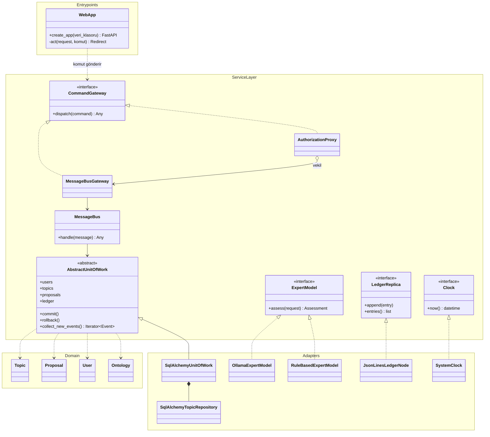

## Alan modeli: kullanıcı, ontoloji, teklif

*Sınıf diyagramı.* Değer nesneleri frozen dataclass'tır. PublicProfile'da kişisel veri alanı yoktur; PrivateProfile yalnızca sahibine verilir.

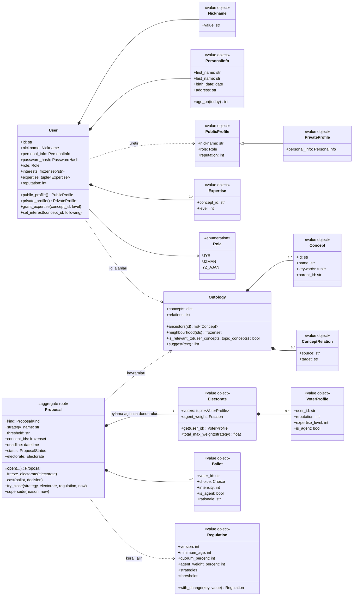

## Composite ve State: konu ağacı ve yaşam döngüsü

*Sınıf diyagramı.* Topic (bileşik) ve Message (yaprak) aynı TopicComponent arayüzünü uygular. Konunun davranışı durum nesnesine devredilir.

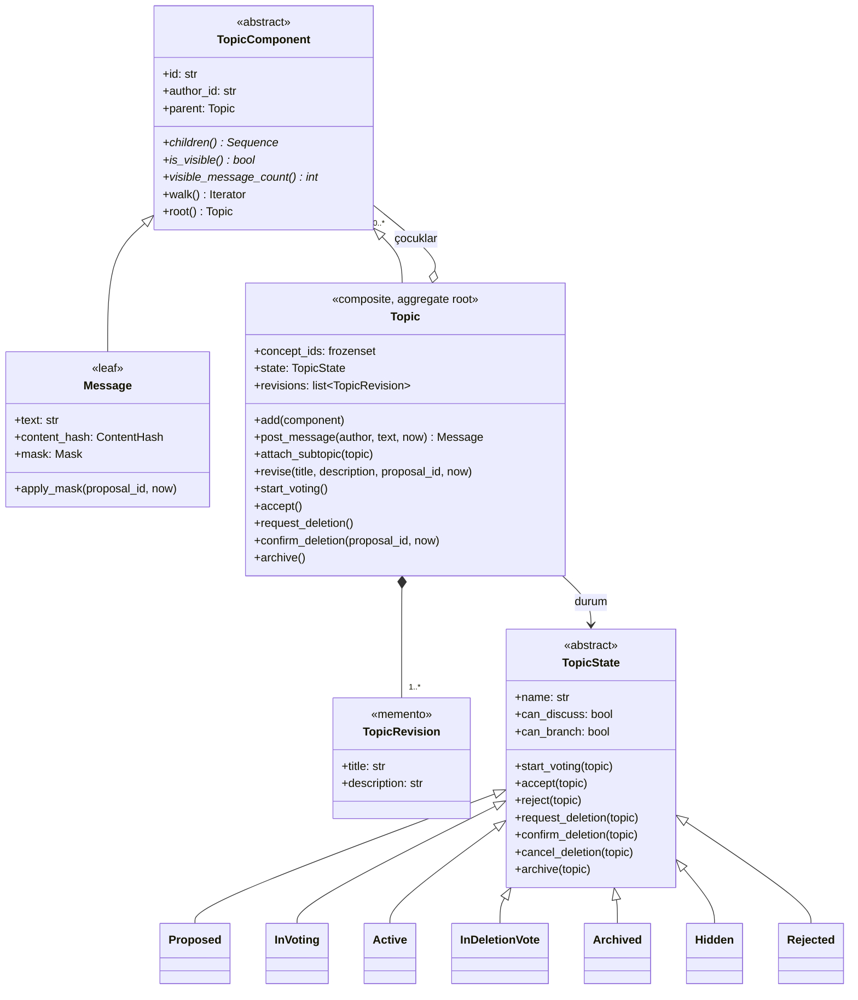

## Konu yaşam döngüsü

*Durum diyagramı.* Önerildi → Oylamada → Aktif → Silinme Oylamasında → Arşivlendi / Gizlendi. Gizlenen kayıt silinmez.

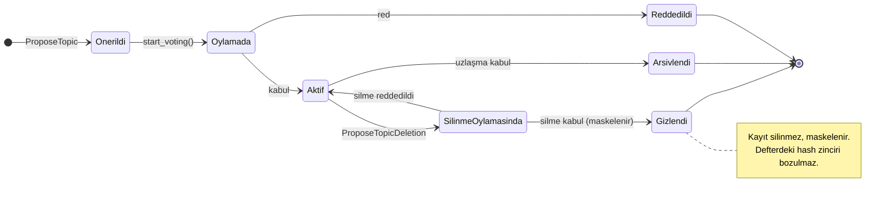

## Strategy: oylama algoritmaları

*Sınıf diyagramı.* Basit çoğunluk, karesel, uzman ağırlıklı ve itibar tabanlı oylama aynı Protocol'ü uygular; Registry ile seçilir.

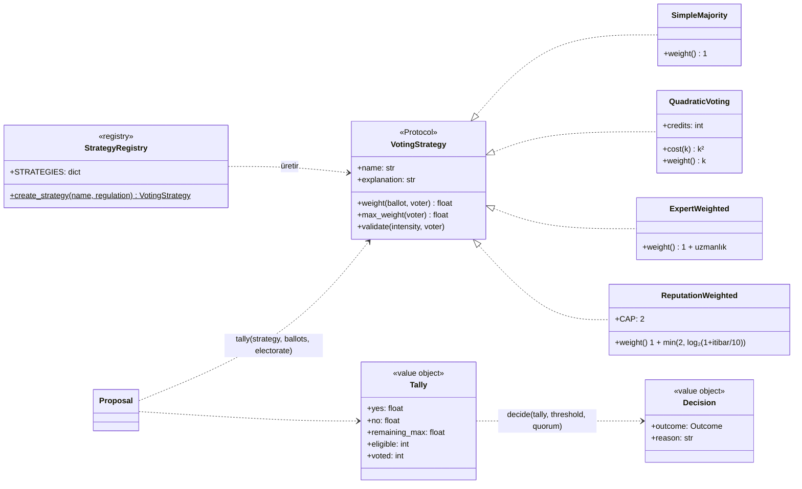

## Chain of Responsibility ve Protection Proxy

*Sınıf diyagramı.* Oy hakkı yedi halkalı zincirle denetlenir. Komutlar ve profiller vekiller (proxy) üzerinden geçer.

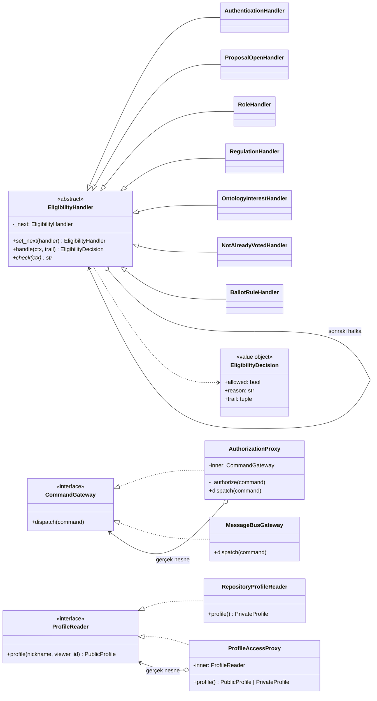

## Observer, Adapter ve Factory/Registry: YZ uzman ajanları

*Sınıf diyagramı.* Oylama başlayınca gözlemciler haberdar edilir; YZ ajanı modelini Registry'den alır, modeller Adapter'dır.

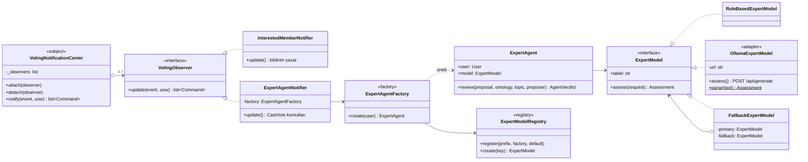

## Repository, Unit of Work ve Message Bus

*Sınıf diyagramı.* Her soyut repository'nin SQLAlchemy ve Fake uygulaması vardır. Hiçbir repository silme metodu sunmaz.

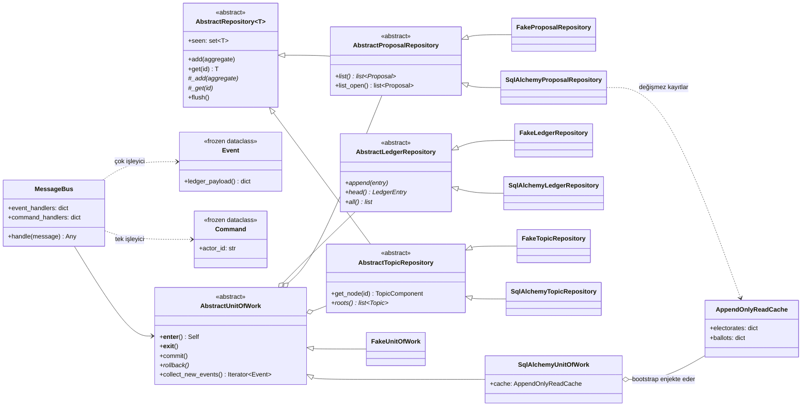

## Dağıtık defter

*Sınıf diyagramı.* Hash zinciri, düğüm kopyaları ve çoğunluk uzlaşması.

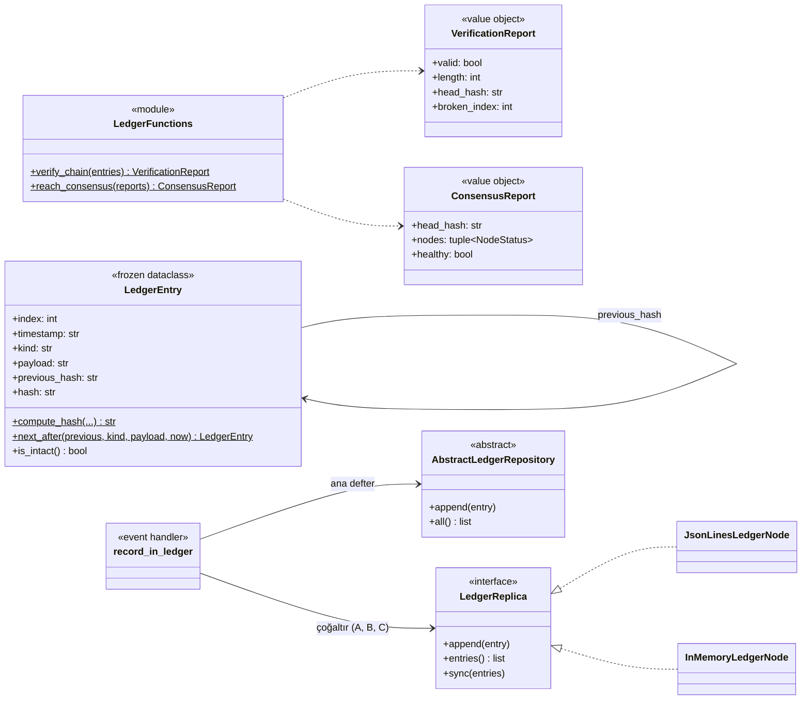

## Konu önerisi

*Sıralama diyagramı.* Komut → Proxy → Message Bus → işleyici → olaylar → defter → Observer → YZ ajanının oyu.

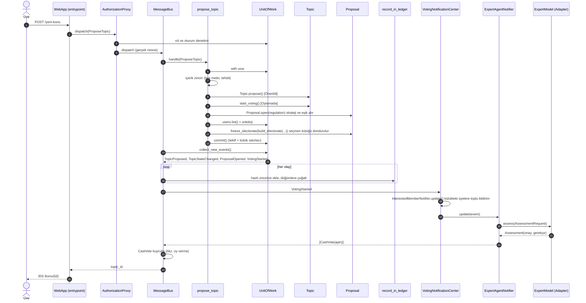

## Oy verme ve sonuçlanma

*Sıralama diyagramı.* Yetki zinciri, strateji, erken karar ve kabul edilen teklifin etkisi.

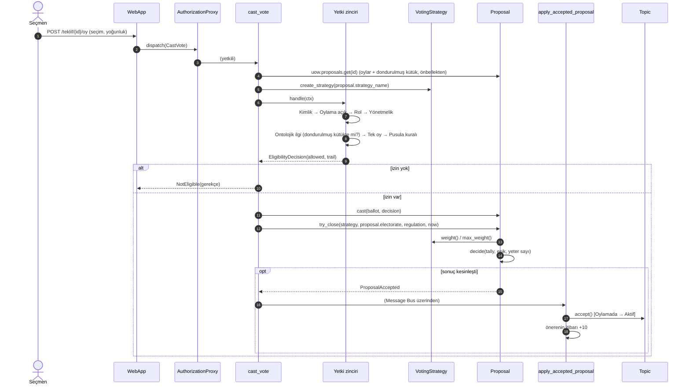

## Mesaj gizleme (karesel oylama)

*Sıralama diyagramı.* Mesaj silinmez, maskelenir; içerik özeti defterde kalır.

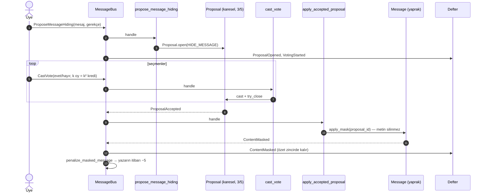

## Profil görüntüleme (PII koruması)

*Sıralama diyagramı.* Protection Proxy, hesap sahibi olmayanlara yalnızca takma adlı profil verir.

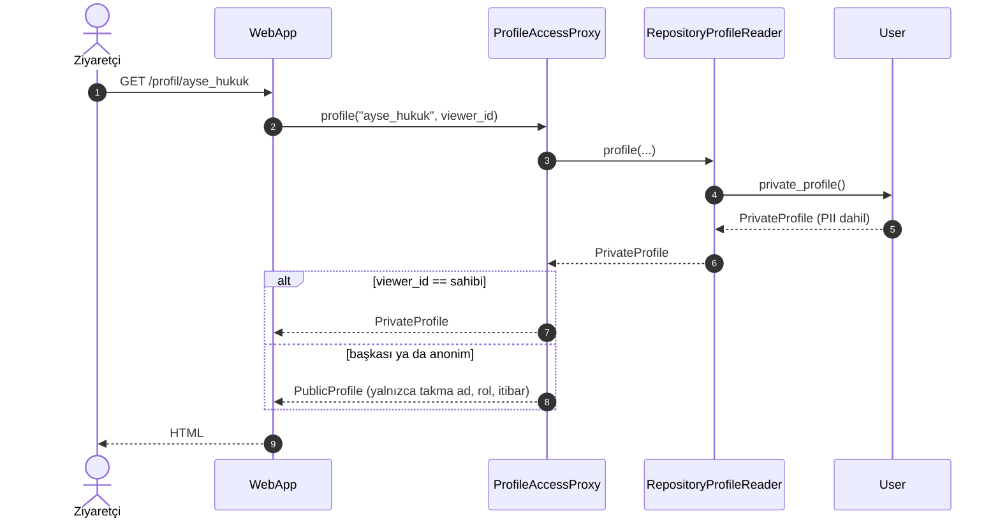

## Defter kaydı, çoğaltma ve doğrulama

*Sıralama diyagramı.* Her olay zincire eklenir, üç düğüme çoğaltılır; uzlaşma raporu kurcalanan düğümü bulur.

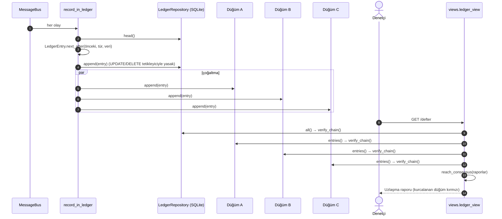
